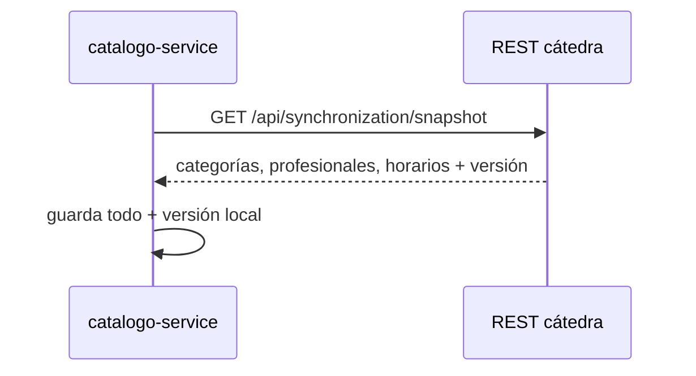
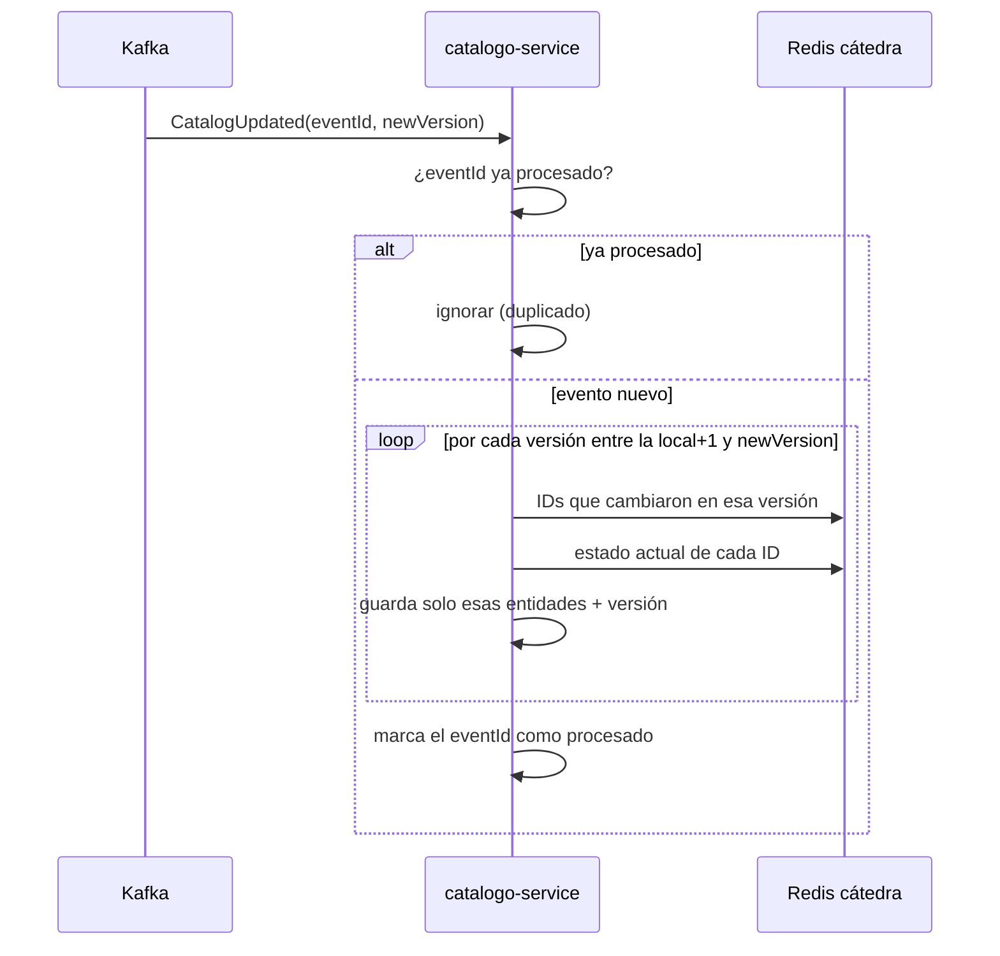

# Sincronización con la cátedra

## Sincronización completa

Se ejecuta al arrancar, si la base local está vacía.

Si la cátedra no responde al arrancar, se loguea el error y el servicio sigue levantado en modo degradado, en vez de caerse.

## Sincronización incremental

Se ejecuta al recibir un evento `CatalogUpdated` por Kafka.

## Idempotencia y recuperación

- **Mensajes duplicados:** cada evento tiene un `eventId` único. Antes de procesarlo se chequea si ya está guardado en `processed_events`; si ya está, se ignora.
- **Mensajes perdidos o fuera de orden:** si la versión local quedó por debajo de lo que Redis todavía puede reconstruir (discontinuidad), o si ocurre cualquier error al aplicar lo incremental, se ejecuta una sincronización completa en su lugar.