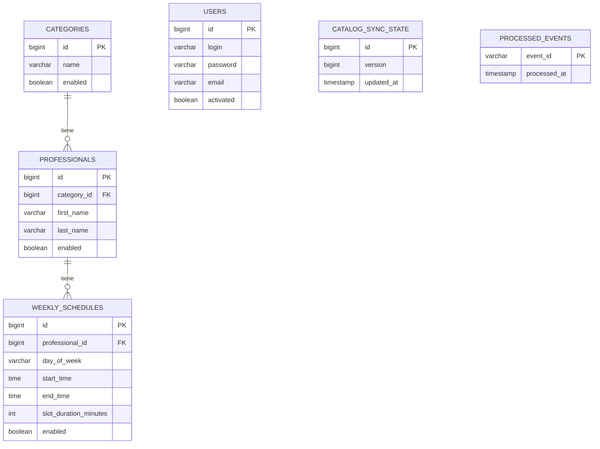

# Modelo de datos

Base propia (`catalogo_db`), de uso exclusivo de catalogo-service. Ningún otro servicio accede a estas tablas directamente. turnos-service solo puede leer estos datos a través de la API interna (`docs/contratos.md`).

- `users`: cuentas de usuario final (login, contraseña hasheada, datos de registro).
- `categories`, `professionals`, `weekly_schedules`: copia local del catálogo publicado por la cátedra. Los `id` son los mismos que usa la cátedra, para poder actualizar por ID en la sincronización incremental.
- `catalog_sync_state`: la versión del catálogo aplicada localmente.
- `processed_events`: eventos de Kafka ya procesados, para idempotencia.
